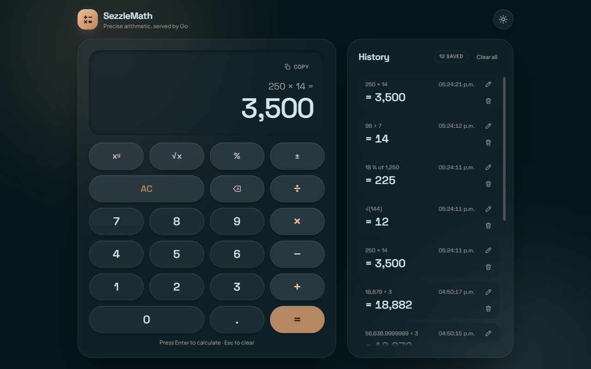
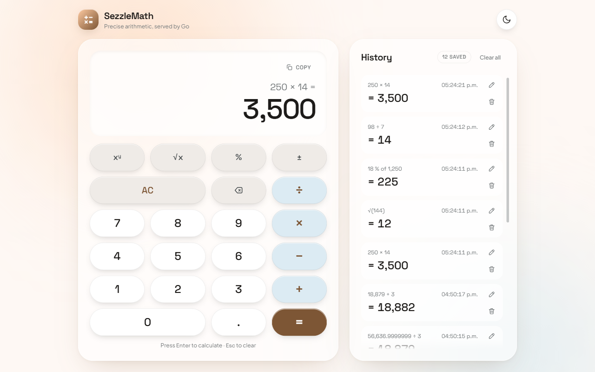

# SezzleMath

A full-stack calculator: a React + TypeScript frontend talking to two small Go microservices over REST.

- **calculator-service** (Go): stateless arithmetic API.
- **history-service** (Go + SQLite): create, list, edit and delete past calculations.
- **frontend** (React 19, TypeScript, Vite, Tailwind CSS v4, Motion): glassmorphism UI with light and dark themes.

```
                      ┌────────────────────────── nginx (frontend container) ─────────────────────────┐
 Browser ── :8080 ──▶ │  /            React SPA (static)                                              │
                      │  /api/calc/*     ──▶ calculator-service :8081   POST /api/v1/calculate        │
                      │  /api/history/*  ──▶ history-service    :8082   CRUD  /api/v1/history         │
                      └───────────────────────────────────────────────────────────────────────────────┘
                                                      history-service ──▶ calculator-service (recompute)
                                                      history-service ──▶ SQLite file (Docker volume)
```

| Dark | Light |
|---|---|
|  |  |

## What the brief asked for, and where it lives

| Requirement | Where |
|---|---|
| Add, subtract, multiply, divide | `calculator-service`, `internal/calculator` |
| Optional: power, square root, percentage | same, all three implemented |
| REST API, JSON, input validation, edge cases | [API](#api) (division by zero, negative root, overflow, malformed JSON, missing or extra operands) |
| React UI, input validation, error handling | `frontend/src/components`, `frontend/src/lib/calculatorModel.ts` |
| Responsive, basic mobile support | one layout down to 375 px; history becomes a slide-over drawer below 1024 px |
| Unit tests for both layers + coverage | [Tests and coverage](#tests-and-coverage) |
| Setup, API examples, design rationale | this file |
| Optional: Dockerfile for the full stack | `Dockerfile` (single image) and `docker-compose.yml` (one container per service) |
| Extra: history | `history-service` and the History panel (create, edit, delete, clear) |

## Quick start

```bash
git clone https://github.com/Chebass/calculator-app.git
cd calculator-app
```

### Docker (recommended)

Requires Docker with Compose. Verified with Docker 28.

```bash
docker compose up --build
```

Open <http://localhost:8080>. History is stored in the `history-data` volume and survives restarts. Stop with `Ctrl+C`; remove the data too with `docker compose down -v`.

Single-container alternative (frontend + both services in one image, handy for a demo):

```bash
docker build -t sezzlemath .
docker run --rm -p 8080:80 -v sezzlemath-data:/data sezzlemath
```

### Local development

Requires Go 1.26+ and Node 20+ (developed with Go 1.27 and Node 24).

```bash
# terminal 1: calculator-service on :8081
cd services/calculator-service && go run ./cmd/server

# terminal 2: history-service on :8082 (stores ./data/history.db)
cd services/history-service && go run ./cmd/server

# terminal 3: frontend on http://localhost:5173
cd frontend && npm install && npm run dev
```

The Vite dev server proxies `/api/calc` and `/api/history` to the two services, mirroring the nginx routing used in Docker, so the browser always talks to a single origin and no CORS setup is needed.

Service settings are environment variables:

| Service | Variable | Default |
|---|---|---|
| both | `PORT` | `8081` (calculator) / `8082` (history) |
| both | `LOG_LEVEL` | `info` |
| both | `CORS_ORIGINS` | `*` (comma-separated list) |
| history | `DB_PATH` | `./data/history.db` |
| history | `CALCULATOR_URL` | `http://localhost:8081` |

## Tests and coverage

```bash
# Go (run in each service directory)
go test ./... -cover
go test ./... -coverprofile=coverage.out && go tool cover -html=coverage.out

# Frontend (text summary + HTML report in frontend/coverage/index.html)
cd frontend && npm test
cd frontend && npm run coverage
```

Measured coverage (statements):

| Package | Coverage |
|---|---|
| calculator-service `calculator`, `handler`, `config` | 100% |
| history-service `history`, `config` | 100% |
| history-service `handler` | 98.5% |
| history-service `calcclient` | 95.5% |
| history-service `store` (memory + SQLite, same contract tests) | 89.8% |
| frontend (all of `src`, except `main.tsx`) | 96.6% |

The two `cmd/server/main.go` entry points are wiring only and are not unit tested; they are exercised by running the stack.

## API

Everything below is also reachable through the frontend origin (`http://localhost:8080/api/calc/...`, `http://localhost:8080/api/history/...`). In the examples, replace the host with `localhost:8081` / `localhost:8082` when calling a service directly (and drop the `/api/calc` or `/api/history` prefix back to `/api`).

All bodies are JSON. Every error uses the same envelope: `{"error": {"code": "...", "message": "..."}}`. Branch on `code`, not on `message`.

### calculator-service

`POST /api/v1/calculate`

| Field | Type | Notes |
|---|---|---|
| `operation` | string | `add`, `subtract`, `multiply`, `divide`, `power`, `sqrt`, `percentage` |
| `a` | number | required |
| `b` | number | required for binary operations, **forbidden** for `sqrt` |

`percentage` means "`a` percent of `b`".

```bash
curl -s -X POST http://localhost:8080/api/calc/v1/calculate \
  -H 'Content-Type: application/json' -d '{"operation":"add","a":2,"b":3}'
# {"operation":"add","result":5}

curl -s -X POST http://localhost:8080/api/calc/v1/calculate \
  -H 'Content-Type: application/json' -d '{"operation":"sqrt","a":144}'
# {"operation":"sqrt","result":12}

curl -s -X POST http://localhost:8080/api/calc/v1/calculate \
  -H 'Content-Type: application/json' -d '{"operation":"divide","a":1,"b":0}'
# 422 {"error":{"code":"DIVISION_BY_ZERO","message":"division by zero"}}
```

`GET /api/v1/operations` lists the supported operations with symbol and arity. `GET /healthz` is the liveness probe.

| Status | `code` | When |
|---|---|---|
| 400 | `INVALID_JSON` | malformed body, unknown field, wrong type, trailing data, body over 1 KiB |
| 400 | `UNKNOWN_OPERATION` | operation not in the list |
| 400 | `MISSING_OPERAND` | `a` missing, or `b` missing for a binary operation |
| 400 | `UNEXPECTED_OPERAND` | `b` sent to `sqrt` |
| 422 | `DIVISION_BY_ZERO` | `b` is 0 in `divide` |
| 422 | `NEGATIVE_SQRT` | `a < 0` in `sqrt` |
| 422 | `UNDEFINED_RESULT` | overflow or no real result, e.g. `0^-1`, `(-8)^0.5` |

### history-service

The result is **never accepted from the client**: on create and update the service asks the calculator-service for it.

| Method and path | Purpose | Success |
|---|---|---|
| `POST /api/v1/history` | store a calculation `{operation, a, b?}` | `201` + entry, `Location` header |
| `GET /api/v1/history?limit=100` | newest first, `limit` 1 to 500 | `200 {"entries": [...]}` |
| `GET /api/v1/history/{id}` | one entry | `200` |
| `PUT /api/v1/history/{id}` | change operation or operands, result is recomputed | `200` |
| `DELETE /api/v1/history/{id}` | delete one | `204` |
| `DELETE /api/v1/history` | clear all | `204` |
| `GET /healthz`, `GET /readyz` | liveness, readiness (checks storage) | `200` |

```bash
curl -s -X POST http://localhost:8080/api/history/v1/history \
  -H 'Content-Type: application/json' -d '{"operation":"multiply","a":250,"b":14}'
# {"id":1,"operation":"multiply","a":250,"b":14,"result":3500,"createdAt":"...","updatedAt":"..."}

curl -s -X PUT http://localhost:8080/api/history/v1/history/1 \
  -H 'Content-Type: application/json' -d '{"operation":"add","a":10,"b":5}'
# {"id":1,"operation":"add","a":10,"b":5,"result":15,...}

curl -s -X DELETE http://localhost:8080/api/history/v1/history/1      # 204
curl -s http://localhost:8080/api/history/v1/history/1                # 404 NOT_FOUND
```

The history-service adds `NOT_FOUND` (404), `INVALID_ID`, `INVALID_LIMIT`, `MISSING_OPERATION` (400) and `CALCULATOR_UNAVAILABLE` (502). Validation errors from the calculator-service (for example `DIVISION_BY_ZERO`) are passed through with the same status and code.

## Design decisions

**Two services, not one.** The brief asks for "a backend microservice". Calculating is stateless and trivial to scale; history is stateful CRUD with persistence. Those are different bounded contexts with different operational needs, so they are separate services. Going further (one service per operation) would be over-engineering, so I stopped at two. A third service is a new folder under `services/`, one compose entry and one nginx `location`.

**Independent services.** Each has its own `go.mod`, Dockerfile, config via environment variables, structured JSON logs (`log/slog`), request IDs, panic recovery, graceful shutdown, health checks and a versioned API (`/api/v1`). They only know each other through HTTP. The small middleware and config helpers are deliberately duplicated instead of shared, so each service builds on its own; extract a shared module when a third service appears.

**Domain, handler, wiring.** `calculator` holds the arithmetic with typed errors (`errors.Is`) and no HTTP knowledge. The handler maps those errors to status codes: 400 for malformed requests, 422 for well-formed requests that cannot be computed. History depends on two small interfaces, `Repository` and `Calculator`, so tests use an in-memory store and a fake calculator, and the same contract tests run against memory and SQLite.

**One generic calculate endpoint.** `POST /calculate` with an `operation` field avoids seven near-identical routes and makes adding an operation a one-place change. `GET /operations` lets clients discover what exists.

**Backend as source of truth.** Operands are `*float64` so "missing" differs from `0`. Unknown JSON fields are rejected, bodies are capped at 1 KiB, and non-finite results (NaN, Inf) are reported as `UNDEFINED_RESULT` rather than serialised. History recomputes results server-side so stored data cannot be forged.

**SQLite via `modernc.org/sqlite`.** Pure Go (no cgo), so the image stays a small static binary, and a file on a volume is enough for this scope. Swapping it for Postgres means writing one more `Repository`.

**Frontend: Vite, not Next.js.** The brief asks for React and TypeScript. This is a client-side app that only calls an API, so server rendering, file routing and a Node server would add weight and Docker complexity without a benefit. Vite builds static files that nginx serves.

**Frontend structure.** `lib/calculatorModel.ts` is a pure reducer for keypad input (no network). `hooks/useCalculator` connects it to the API; `hooks/useHistory`, `useTheme`, `useKeyboard` each do one job. Components are presentational. Obvious mistakes (divide by zero, square root of a negative) are reported instantly on the client, but the server still enforces the same rules and its errors are shown too. A failing history service never blocks the calculator.

**Chain calculator model.** The API is binary (`a op b`), so the UI is a classic chain calculator: `2 + 3 ×` computes `5` first, then continues. There is no expression parser or parentheses.

**Motion and theming.** The theme switch uses a circular reveal (View Transitions API, with a plain fallback). Keys spring on press, the active operator highlight glides between keys, results roll in, errors shake and history rows enter and leave with layout animation. Everything respects `prefers-reduced-motion`. Light ("Sand Glass") and dark ("Slate Glass") themes are CSS variables swapped by `data-theme`; the first visit follows the OS preference and the choice is remembered.

**Accessibility.** Native buttons with labels, `aria-pressed` on the pending operator, an `aria-live` result, `role="alert"` errors, keyboard input (digits, `+ - * / ^ %`, `Enter`, `Backspace`, `Esc`) and visible focus rings.

**Docker.** Multi-stage builds, non-root users, health checks, and compose waits for healthy dependencies. nginx serves the SPA and proxies `/api/calc` and `/api/history`, so there is one origin and no CORS in production.

## Scope, assumptions and trade-offs

- **Scope.** The design mockups (made before coding, see below) also showed scientific, converter and matrix modes, trigonometry, parentheses and memory keys. I left those out on purpose: the brief asks for correctness and clarity over extra features. The mockups still drive the visual design (palette, typography, glass surfaces, layout).
- **Numbers.** IEEE-754 `float64`. The UI rounds to 12 significant digits so `0.1 + 0.2` reads `0.3`; the API returns the raw value.
- **History.** Only successful calculations are saved. There are no users: it is one shared list per deployment.
- **Security.** No authentication or rate limiting. A real deployment would put both services behind a gateway that provides them. Inputs are validated, bodies are size-capped, containers run as non-root.
- **Untested glue.** The two `cmd/server/main.go` files (wiring only) have no unit tests. The Docker stack was smoke-tested by hand through nginx (calculate, error case, history write and read, history surviving a restart).
- **Duplication on purpose.** Middleware and config helpers are copied between the two Go services instead of shared. It keeps each service independently buildable; it would become a shared module with a third service.

## What I would do next

- End-to-end test (Playwright) against the compose stack, and a CI workflow running `go test`, `npm run coverage` and `docker compose build`.
- An OpenAPI file for both services and contract tests between `history-service` and `calculator-service`.
- Propagate the request ID from `history-service` to `calculator-service` so one user action can be traced across both logs.
- Replace the nginx path routing with a real gateway if more services appear; add auth and rate limiting there.
- Optional expression mode (parser with parentheses) behind a new `evaluate` operation.

## Built with AI

I used Claude Code throughout: planning and stack decisions, implementation, tests, Docker and documentation, plus the design mockups made beforehand with Stitch. A final AI code review and security review ran over the whole codebase; the bugs it found were fixed with regression tests. [PROMPTS.md](PROMPTS.md) describes the workflow, the prompts that shaped the project, and the mistakes I caught in AI output.

## Project layout

```
services/calculator-service/   cmd/server, internal/{calculator,handler,config}
services/history-service/      cmd/server, internal/{history,store,calcclient,handler,config}
frontend/                      src/{api,hooks,lib,components,test}, nginx.conf.template
Dockerfile                     all-in-one image
docker-compose.yml             multi-container stack
stitch_calculator_app/         design mockups (images only), used as visual reference
PROMPTS.md                     how AI tools were used, and the prompts behind the project
```
